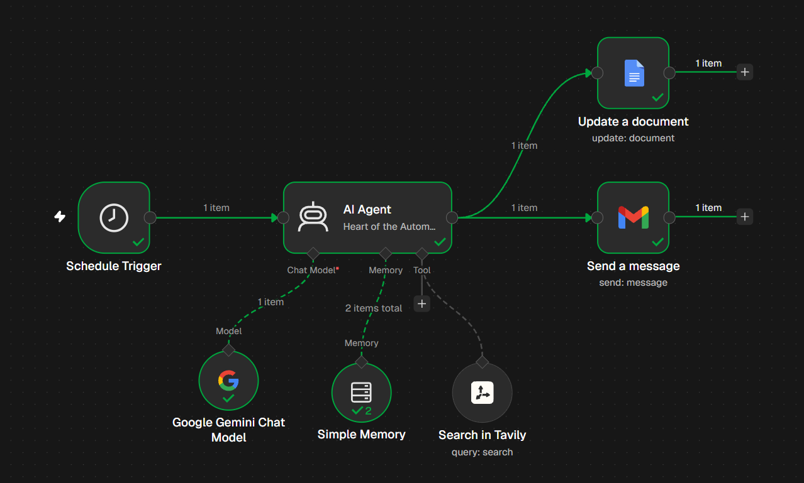

# AI News Digest Automation (n8n)

An [n8n](https://n8n.io) workflow that runs on a schedule, uses an AI agent to search the web for the latest news on a topic, then saves the result to a Google Doc and emails it to you.

> Default topic: AI-related news. Change the topic in the AI Agent's prompt to use it for anything else.



## How it works

```
Schedule Trigger
      |
      v
  AI Agent  <---- Google Gemini Chat Model (the brain)
      |     <---- Simple Memory (short-term context)
      |     <---- Tavily Search (web/news search tool)
      |
      +--> Update a document (Google Docs)
      |
      +--> Send a message (Gmail)
```

1. **Schedule Trigger** starts the workflow at a set time (for example, every morning).
2. **AI Agent** receives the prompt, decides what to search, and calls the Tavily tool.
3. **Google Gemini Chat Model** reads the results and writes the summary.
4. **Simple Memory** keeps recent context so the agent stays consistent within a run.
5. **Google Docs** node appends or updates the summary in a document.
6. **Gmail** node emails the same summary to you.

## Tech stack

| Part | Tool |
|---|---|
| Automation engine | n8n (self-hosted in Docker) |
| LLM | Google Gemini |
| Web search | Tavily API |
| Storage | Google Docs |
| Notification | Gmail |

## Prerequisites

- [Docker Desktop](https://www.docker.com/products/docker-desktop/)
- A Google account
- A Google Cloud project with the **Gmail API**, **Google Docs API** and **Google Drive API** enabled
- A Google Gemini API key from [Google AI Studio](https://aistudio.google.com)
- A Tavily API key from [tavily.com](https://tavily.com)

## Setup

### 1. Run n8n locally

```bash
docker volume create n8n_data

docker run -d --name n8n --restart unless-stopped \
  -p 5678:5678 \
  -e GENERIC_TIMEZONE=Asia/Kolkata \
  -e TZ=Asia/Kolkata \
  -e N8N_ENCRYPTION_KEY=<your-long-random-string> \
  -v n8n_data:/home/node/.n8n \
  n8nio/n8n:latest
```

Open http://localhost:5678 and create your owner account.

### 2. Import the workflow

1. Create a new workflow in n8n.
2. Click the `...` menu, then **Import from file**.
3. Select `workflows/ai-news-digest.json` from this repo.

### 3. Add your own credentials

Credentials are **not** included in this repo. Create each one in n8n and select it on the matching node.

| Node | Credential type | Where to get it |
|---|---|---|
| Google Gemini Chat Model | Google Gemini (PaLM) API | Google AI Studio |
| Search in Tavily | Tavily API | Tavily dashboard |
| Update a document | Google Docs OAuth2 | Google Cloud Console |
| Send a message | Gmail OAuth2 | Google Cloud Console |

For the Google OAuth credentials, set this redirect URI in Google Cloud:

```
http://localhost:5678/rest/oauth2-credential/callback
```

Also add your Google account as a **test user** on the OAuth consent screen.

### 4. Configure the workflow

- **Google Docs node:** set your own Document ID (the long string in the doc's URL).
- **Gmail node:** set the recipient email address.
- **Schedule Trigger:** set the time and frequency you want.
- **AI Agent:** edit the system prompt to change the news topic or output format.

### 5. Test and publish

1. Click **Execute workflow** and check that each node shows a green tick.
2. Click **Publish** so the schedule runs automatically.

> **Tip:** If you test with a broken credential, the Simple Memory node can keep repeating the old error. Restart the container (`docker restart n8n`) to clear it, and remove any failed output from your Google Doc.

## Security

- Never commit API keys, OAuth client secrets, or your `N8N_ENCRYPTION_KEY`.
- Never commit the `n8n_data` volume or its `database.sqlite` file. It stores your credentials.
- Before sharing the workflow JSON, check it for personal data such as email addresses, Google Doc IDs, `pinData` sections, and any key pasted directly into a node.
- Keep any local `.env` file out of the repo. It is already listed in `.gitignore`.
- If a key is ever pushed to GitHub, revoke it immediately. Deleting the commit is not enough.

## Troubleshooting

| Problem | Likely fix |
|---|---|
| `access_denied` on Google sign-in | Add your account as a test user on the OAuth consent screen |
| `Gmail API has not been used in project...` | Enable the Gmail API in Google Cloud, wait a minute, retry |
| Agent says it has no credentials for search | Add the Tavily API key and select it on the Tavily node |
| Agent keeps repeating an old error | Restart n8n to clear Simple Memory, then rerun |
| `redirect_uri_mismatch` | The redirect URI in Google Cloud must match the one shown in n8n exactly |
| Google connection breaks after ~7 days | Publish the OAuth app to production, or reconnect the credential |

## Project structure

```
.
├── images/
│   └── workflow.png
├── workflows/
│   └── ai-news-digest.json
├── .gitignore
└── README.md
```

## License

MIT. Add a `LICENSE` file to make this official.